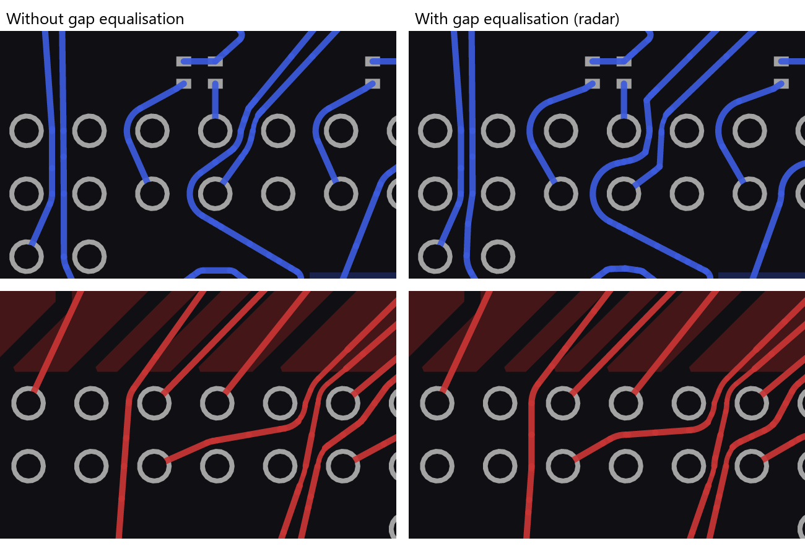

# GridLess

English | [Русский](README.ru.md)

[](https://github.com/bat654321/GridLess/actions/workflows/ci.yml)
[](LICENSE)

**A gridless, topological autorouter for KiCad 10 — any-angle tracks with arcs,
differential pairs, length matching and a DRC feedback loop.**

GridLess is built in the spirit of TopoR. It does not fill a grid with 45° segments.
First it decides *which side of which obstacle* every connection passes; then it
draws the exact geometry: straight chords at any angle, arcs around pads and
concentric bundles. The result looks routed by hand rather than generated.



## Status

GridLess is at an early testing stage. On the author's 4-layer *Carrier* board it
matches the hand routing on clearance correctness and uses fewer vias:

| Carrier: 4 layers, 43 parts, 281 pads, 75 nets | Hand routing | GridLess |
|---|---|---|
| Clearance errors / shorts / crossings (KiCad DRC) | 0 | 0 |
| Vias | 30 | 28 (23 without a config file) |
| Track length | 1330 mm | 1286 mm (including meanders) |
| Corners sharper than 120° | — | 0 |
| Unconnected items | 1 | 4 (islands of the GND pour) |
| Starved thermals | 3 | 4 |
| Routing time | — | ≈ 11 s (≈ 4 s without the zone check) |

A second board, *Beacon* (BLE module, 0.4 mm-pitch QFN, split power plane, RF
section), is still the open problem: about 12 DRC violations and 3 unconnected
nets around the RF part. Dense fine-pitch parts and RF keepouts need more work.
Please treat GridLess as an assistant, not as a guarantee: save your board and
keep a backup or use version control.

## Features

- **Topology first, geometry second.** A planar sketch decides who goes around
  whom; the rubber-band geometry then minimises length under clearance rules.
- **Any-angle copper.** Straight tracks under any angle, arcs around pads,
  concentric bundles, automatic necking in narrow places.
- **Differential pairs** stay coupled on one layer, may choose equivalent pins
  and get their skew compensated through intermediate components.
- **Length matching** with rounded meanders; room for them can be reserved
  during topology, as in TopoR.
- **Layers and vias.** Preferred direction per layer, via minimisation, plane
  connections, split planes.
- **Gap equalisation ("radar").** Between two close pads a track runs in the
  middle; bundles get equal gaps. Pads that stand far apart do not pull tracks.
- **Smoothing.** Straight entries into pads and arcs instead of kinks.
- **DRC feedback.** The router's own clearance and connectivity check runs after
  every geometry pass; the best round is kept. With `--kicad-check` it also
  refills zones through `kicad-cli`, adds plane vias where a pour does not reach
  a pad, and routes again.
- **Deterministic output.** The same binary on the same board gives the same
  result, byte for byte.
- **Localised interface.** The plugin follows the language selected in KiCad and
  ships with translations for all 44 languages available in KiCad 10.

## Installation

### Plugin and Content Manager (recommended)

1. Download `gridless-<version>-pcm.zip` from the
   [Releases](https://github.com/bat654321/GridLess/releases) page.
2. In KiCad: **Tools → Plugin and Content Manager → Install from File…**
3. When KiCad offers to enable the API server, accept it, or enable it later in
   **Preferences → Plugins → Enable KiCad API**.
4. Open the PCB editor and click **GridLess** on the toolbar. The first
   start creates a Python environment and installs `kicad-python`; this can take
   a minute.

This package uses the IPC API: it routes the open board *including unsaved
edits* and inserts the result as a single undo step. On macOS the bundled router
is ad-hoc signed; if Gatekeeper blocks it, allow it in **System Settings → Privacy
& Security**.

The plugin dialogs use wxWidgets. KiCad's bundled Python on Windows and macOS
includes it. On Linux, the external Python that KiCad chooses may not; in that
case the plugin still routes, using the default options and printing the report.
Install `wxPython` if you want the dialogs there, or use the classic plugin.

### Third-party PCM repository (available now)

The package is also served from a small repository on GitHub Pages, so it can be
installed and updated through KiCad before it appears in the official catalogue.
In **Tools → Plugin and Content Manager → Manage repositories**, add:

```
https://bat654321.github.io/GridLess/repository.json
```

Then GridLess appears in the PCM package list. The official KiCad repository
submission is open at
[kicad/addons/metadata!759](https://gitlab.com/kicad/addons/metadata/-/merge_requests/759).

### Classic plugin and manual install

The repository also contains the classic SWIG action plugin, which works without
the API server but routes the **saved** board file. To install both flavours plus
the router executable:

```bash
cargo build --release
python kicad_plugin/install.py
```

Restart KiCad (or **Tools → External Plugins → Refresh**). The installer writes to
`Documents/KiCad/10.0` on Windows, and to the equivalent user folder elsewhere.

The plugin asks whether to keep existing tracks, how many DRC feedback rounds to
run, and whether to check copper pours with KiCad. During routing a progress
window shows the stage, a live log and a **Cancel** button. The final report lists
items, vias, track length, unrouted connections, DRC findings and length matching.

## Command line

```bash
gridless route board.kicad_pcb -o board_routed.kicad_pcb
```

| Option | Meaning |
|---|---|
| `-o FILE` | write the routed board (the source is untouched) |
| `-c FILE` | settings file; defaults to `<board>.gridless.toml` next to the board |
| `--keep-existing` | keep existing tracks and route only missing connections |
| `--kicad-check` | refill zones with `kicad-cli`, add plane vias, route again |
| `--rounds N` | number of "geometry → DRC → reroute" rounds (default 8) |
| `--png FILE [--view x0,y0,x1,y1 --scale K]` | render the result (violations as pink dots) |
| `--json-out FILE` | result as JSON (used by the plugins) |
| `--project FILE` | explicit `.kicad_pro` with net classes |

`gridless info board.kicad_pcb` prints a summary of the board.

## Configuration

Everything is optional. By default GridLess uses the net classes and design rules
from the KiCad project, detects differential pairs by KiCad's suffix rules
(`_P/_N`, `+/-`, `P/N`), and treats inner layers that are almost completely covered
by zones as planes. A commented example:
[docs/example.gridless.toml](docs/example.gridless.toml).

```toml
[layers."F.Cu"]
direction = "horizontal"
[layers."B.Cu"]
direction = "vertical"

[[nets]]
match = ["+5", "3V3"]
width = 0.8            # necked down automatically where space is tight

[[length_groups]]
match = ["DATA*"]
tolerance = 0.5

[[diff_pairs]]
p = "USB_P"
n = "USB_N"
max_skew = 0.1
```

### Gap equalisation

The rubber band pulls tracks tight against the pads they pass. The last
post-processing step moves them instead to the middle of the gap: between two
pads a track runs through the centre, and a bundle gets equal gaps. Clearance
rules always win; the remaining room is shared equally. A "radar" disables the
effect for pads that are far apart.

```toml
[centering]
enabled = true   # on by default
full = 1.3       # mm; default 2 "channels"
range = 3.25     # mm; default 5 channels
```

### Other settings

- `length_reserve = "auto" | "always" | "off"` reserves room for meanders during
  topology; `auto` tries both and keeps the better result.
- Smoothing turns pad entries straight and rounds the remaining kinks with arcs.
- Differential-pair vias are placed side by side across the pair direction.

See the [analysis](docs/ANALYSIS.md) for the ideas taken from TopoR, Situs,
SPECCTRA, Freerouting, Topola and others, and the
[reference](docs/REFERENCE.md) for every feature, algorithm and setting.

## How it works

```
crates/gridless/src/
  kicad.rs      read .kicad_pcb/.kicad_pro, write tracks
  config.rs     settings and resolved rules
  problem.rs    obstacles, via sites, connection plan
  mesh.rs       constrained Delaunay triangulation per layer
  topo.rs       topological router (A*, negotiation, rip-up, vias)
  geometry.rs   rubber-band geometry, arcs, necking, pairs, gap equalisation
  smooth.rs     straight pad entries and rounded kinks
  tuning.rs     meanders, pair skew, length reserve
  drc.rs        the router's own design-rule check
  pipeline.rs   full loop with DRC feedback
kicad_plugin/   KiCad plugins, installer, translations, PCM packaging
docs/           analysis, example settings, articles
```

The stages are described in more detail in the article
[GridLess: a TopoR-style gridless autorouter for KiCad 10](docs/articles/gridless.en.md).

## Interface languages

The plugin asks KiCad for the language chosen in **Preferences → Common Settings →
Language** and falls back to the operating-system language when KiCad is set to
*Default*. Catalogs cover all languages shipped with KiCad 10: Arabic, Bulgarian,
Catalan, Chinese (Simplified and Traditional), Croatian, Czech, Danish, Dutch,
English, Estonian, Farsi, Finnish, French, Georgian, German, Greek, Hebrew, Hindi,
Hungarian, Indonesian, Italian, Japanese, Korean, Latvian, Lithuanian, Norwegian,
Polish, Portuguese (and Brazil), Romanian, Russian, Serbian, Slovak, Slovenian,
Spanish (and Latin America), Swedish, Tamil, Telugu, Thai, Turkish, Ukrainian and
Vietnamese.

The translations were prepared with AI assistance and are first drafts. Native
speakers are welcome to improve them; each language is one JSON file in
`kicad_plugin/common/locales/`. Run `python kicad_plugin/check_i18n.py` after an
edit. Set `GRIDLESS_LANG=ru` (or any KiCad language code/label) to override the
detection while testing.

## Limitations and plans

- Length matching uses meanders on straight runs only; if there is no room even
  with the reserve, the report says **NOT MET**.
- Preferred layer directions guide layer and corridor choice, but the final
  rubber band is isotropic, so diagonals remain.
- Dense 0.4 mm packages and RF keepouts (Beacon) are not solved yet.
- Copper-pour islands are not stitched with vias automatically.
- Only the IPC plugin takes unsaved edits; the classic plugin routes the saved
  file.
- Parallel CPU variants with an archive of results are the next engine step; GPU
  acceleration does not help at this board size (see the analysis).

## Building

```bash
cargo build --release
cargo test --release
```

The executable is `target/release/gridless` (`.exe` on Windows). The PCM package
is built with:

```bash
python kicad_plugin/pcm/build_pcm.py --windows target/release/gridless.exe
```

See [docs/PUBLISHING.md](docs/PUBLISHING.md) for the release and submission
checklist.

## Contributing

Issues and pull requests are welcome. Please include a board or a minimal
reproduction when reporting a routing problem, and say which KiCad version and
platform you used. See [CONTRIBUTING.md](CONTRIBUTING.md).

## License

MIT. See [LICENSE](LICENSE).
