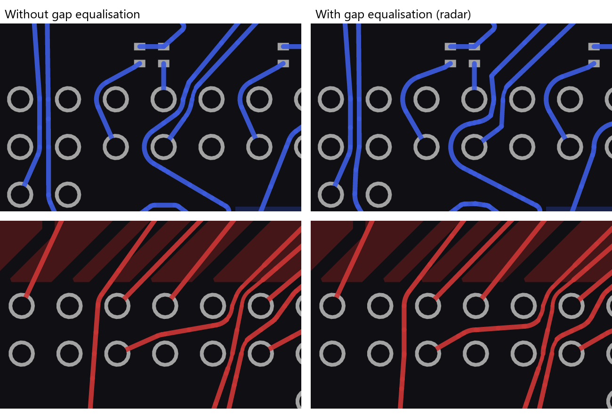

# GridLess: a gridless, TopoR-style autorouter for KiCad 10

I have been building an autorouter that does not use a grid or 45° segments. It
is called **GridLess**: it first builds a planar *topology* (which side of which
obstacle every connection passes), then draws any-angle tracks with arcs around
pads, concentric bundles, differential pairs and length matching.



**Result on my 4-layer reference board** (43 parts, 281 pads, 75 nets, inner
layer 1 is a GND plane), checked with KiCad 10's own DRC after a zone refill:

| | Hand routing | GridLess |
|---|---|---|
| Clearance errors / shorts / crossings | 0 | 0 |
| Vias | 30 | 28 |
| Track length | 1330 mm | 1286 mm (with meanders) |
| Corners under 120° | — | 0 |
| Routing time with zone check | — | ≈ 11 s |

The same board with no config file and no zone check routes in about 4 s with 23
vias. It is deterministic: the same binary gives the same board byte for byte.

**What is inside**

- topology first: A* over a constrained Delaunay mesh, negotiated congestion,
  rip-up and reroute, candidate via sites;
- geometry second: rubber-band minimisation, arcs around pads, automatic necking;
- differential pairs stay coupled and are skew-compensated through intermediate
  components; length matching uses rounded meanders, with room reserved during
  topology;
- preferred layer directions, via minimisation, planes and split planes;
- "gap equalisation": between two close pads a track runs in the middle, and a
  bundle gets equal gaps, with a radar that ignores pads that are far apart;
- a DRC feedback loop and an optional `kicad-cli` zone check that adds plane vias
  where a pour does not reach a pad;
- two front ends: an IPC API plugin (routes the open board including unsaved
  edits, one undo step, progress window with Cancel) and a classic SWIG plugin
  that works without the API server but routes the saved file.

**Honest limits.** A second board, a BLE module with a 0.4 mm QFN, a split power
plane and an RF section, still ends with about 12 DRC violations and 3
unconnected nets around the RF part. Dense fine-pitch parts and RF keepouts are
the next problem to solve. Length matching only works on straight runs and may
report "NOT MET". Treat it as an assistant: keep a backup of the board.

**Install**

Download `gridless-0.1.0-pcm.zip` from the
[Releases](https://github.com/bat654321/GridLess/releases) page and use
**Tools → Plugin and Content Manager → Install from File…**. Accept the offer to
enable the KiCad API. The first start creates a Python environment and installs
`kicad-python`, which can take a minute.

Or from source:

```bash
cargo build --release
python kicad_plugin/install.py
```

The plugin interface follows the language selected in KiCad and is translated
into all 44 languages available in KiCad 10. The translations are first drafts;
native speakers are welcome to improve them.

Source, documentation and the longer write-up:
<https://github.com/bat654321/GridLess>

If you have a board it fails on, please open an issue with a minimal
reproduction — that is the most useful feedback right now.
