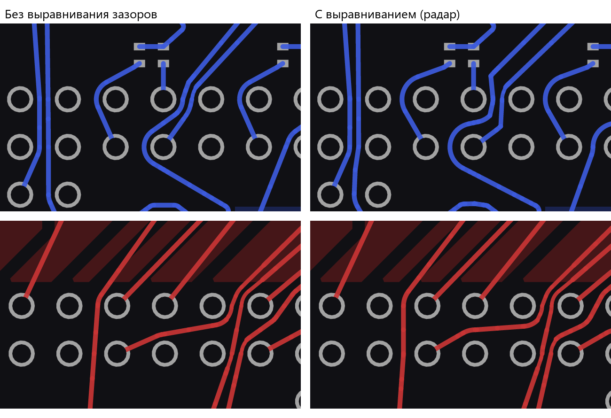

# GridLess — бессеточный автотрассировщик в духе TopoR для KiCad 10

Я делаю автотрассировщик, который не использует сетку и не режет медь под 45°.
Он называется **GridLess**: сначала строится планарная *топология* (с какой
стороны какого препятствия проходит каждое соединение), затем рисуется точная
геометрия — отрезки под любыми углами, дуги вокруг площадок, концентрические
пучки, дифференциальные пары и выравнивание длин.



**Результат на моей 4-слойной плате** (43 компонента, 281 площадка, 75 цепей,
внутренний слой 1 — полигон GND), проверено штатным DRC KiCad 10 после заливки
зон:

| | Ручная разводка | GridLess |
|---|---|---|
| Ошибки зазоров / замыкания / пересечения | 0 | 0 |
| Переходные отверстия | 30 | 28 |
| Длина трасс | 1330 мм | 1286 мм (с меандрами) |
| Углы меньше 120° | — | 0 |
| Время с проверкой заливок | — | ≈ 11 с |

Без файла настроек и без проверки заливок плата разводится примерно за 4 с и
получает 23 переходных. Результат детерминированный: один и тот же бинарник
даёт побайтово одинаковую плату.

**Что внутри**

- сначала топология: A* по триангуляции Делоне, переговоры о перегрузке,
  rip-up и повторная прокладка, кандидаты мест переходных;
- затем геометрия «резиновой нити», дуги вокруг площадок, автоматическое
  сужение трасс;
- дифференциальные пары остаются сцепленными, перекос компенсируется через
  промежуточные компоненты; выравнивание длин — меандрами, место под них
  резервируется ещё на этапе топологии;
- предпочтительные направления слоёв, минимизация переходных, плоскости и
  разделённые плоскости;
- выравнивание зазоров: между близкими площадками трасса идёт посередине, пучок
  получает равные зазоры, а «радар» отключает эффект для далеко стоящих площадок;
- обратная связь DRC и опциональная проверка заливок через `kicad-cli`, которая
  добавляет переходные к плоскости там, где заливка не дошла до площадки;
- два фронтенда: плагин IPC API (трассирует открытую плату вместе с
  несохранёнными правками, один шаг отмены, окно прогресса с Cancel) и
  классический SWIG-плагин (работает без API-сервера, но трассирует
  сохранённый файл).

**Честные ограничения.** Вторая плата — BLE-модуль с QFN 0,4 мм, разделённой
плоскостью питания и RF-узлом — пока заканчивается примерно 12 нарушениями DRC и
3 неподключёнными цепями в RF-части. Плотные корпуса с мелким шагом и запретные
зоны RF — следующая задача. Выравнивание длин работает только на прямых участках
и может сообщать «NOT MET». Относитесь к трассировщику как к помощнику: сохраните
резервную копию платы.

**Установка**

Скачайте `gridless-0.1.0-pcm.zip` со страницы
[Releases](https://github.com/bat654321/GridLess/releases) и используйте
**Инструменты → Менеджер плагинов и контента → Установить из файла…**.
Согласитесь включить KiCad API. При первом запуске KiCad создаёт окружение Python
и ставит `kicad-python` — это может занять минуту.

Или из исходников:

```bash
cargo build --release
python kicad_plugin/install.py
```

Интерфейс плагина следует языку, выбранному в KiCad, и переведён на все 44 языка,
доступные в KiCad 10. Переводы — первые версии; носители языка могут их улучшить.

Исходники, документация и большая статья:
<https://github.com/bat654321/GridLess>

Если есть плата, на которой трассировщик ошибается, пришлите минимальный
воспроизводимый пример в issue — сейчас это самая полезная обратная связь.
