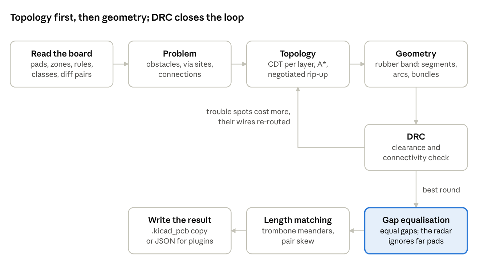
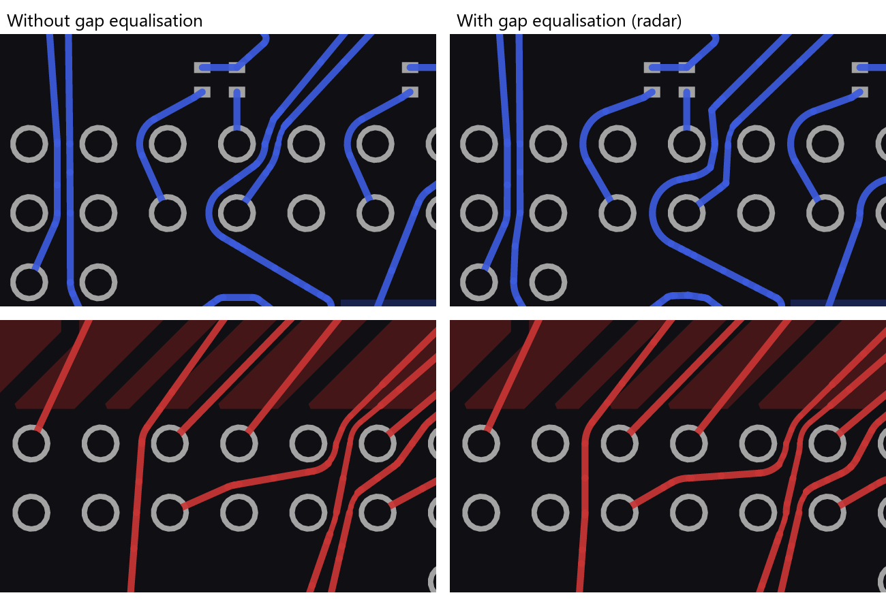

# GridLess: a TopoR-style gridless autorouter for KiCad 10

*2026-10-20*

GridLess is a gridless, topological autorouter for KiCad 10, written in Rust and built in one day of pair work between an engineer and Claude. On the engineer's hand-routed reference board it now routes with zero DRC errors, fewer vias than the hand routing and tracks that run through the middle of pin gaps.

## Why build it

KiCad ships no autorouter of its own; the usual path is a Specctra export to Freerouting, which lays tracks in 45° segments. The goal here was a router in the spirit of TopoR: decide the topology first (which side of which obstacle every wire passes), then draw any-angle tracks with arcs, so the board looks hand-made rather than gridded.

The engineer fixed the requirements on day one (2026-10-20):

- **Form**: a Rust core library, a command-line tool that works on `.kicad_pcb`, and a KiCad 10 plugin that reads the rules straight from the KiCad project.
- **Geometry**: any-angle tracks with arcs around pads, TopoR style.
- **Scale**: 2–4 layers, up to about 300 nets.
- **High-speed**: differential pairs and length matching.
- **Layers**: a preferred direction per layer (one mostly horizontal, another mostly vertical).
- **Vias**: allowed, but as few as possible; the test via is 0.5 mm / 0.3 mm drill.
- **Hardware**: GPU acceleration was considered and rejected — at this size the work is branchy graph search, so CPU threads are the right tool.

The quality bar was the engineer's own hand routing of a real board, *Carrier*: 4 layers (inner layer 1 is a GND plane), 43 parts, 281 pads, 75 nets, 30 vias and 1330 mm of track.

## Architecture: topology first, geometry second

GridLess splits routing into two problems, as TopoR does: first decide *which side of which obstacle* each wire passes, then compute the exact shape. The topology is cheap to change and always planar; the geometry is computed once the topology is good.

Before writing code we surveyed the field (TopoR, Altium Situs, SPECCTRA, Freerouting, Topola, the gEDA toporouter and the SURF rubber-band papers, KiCad's own push-and-shove router, OrthoRoute). From each we took one idea: the topology/geometry split and concentric arc bundles from TopoR, negotiated congestion (conflicts allowed but ever more expensive) from Situs and PathFinder, layer direction costs and "keep the best board" from Freerouting, the spade triangulation crate and stacked bends from Topola, trombone meanders and skew compensation on the short wire from KiCad.

The stages:

1. **Reading the board.** Pads of every shape, outline, zones and keepouts, copper polygons, net classes from `.kicad_pro`, differential pairs by KiCad's own suffix rules (`_P/_N`, `+/-`, `P/N`), and planes — an inner layer mostly covered by zones, split planes included.
2. **The problem.** Obstacles become rounded convex polygons; connections come from a spanning tree per net, plus pair connections and vias down to planes; candidate via sites are scattered over free space. Fine-pitch pads get a short straight escape stub.
3. **Topology.** Each layer gets a constrained Delaunay triangulation of the obstacle corners. A wire is a sequence of crossed mesh edges with a strict order on every edge, so the sketch is planar by construction. A* searches states "edge + gap between the wires already there"; crossing a foreign wire means ripping it up. Edge overflow is allowed with a cost that grows from iteration to iteration and a history of conflicts, as in PathFinder. A separate pass tries every connection that uses vias without them.
4. **Geometry.** A fresh triangulation of the real obstacles only; every wire is re-threaded through it. The variables are the positions where wires cross mesh edges. Inside a triangle a wire is a straight chord or an arc around the shared corner, and an arc's radius stacks on top of the wires nested inside it — TopoR's concentric bundles. Total length is minimised by coordinate descent under clearance constraints, starting from a funnel (string-pulling) solution. Where room is short, tracks neck down automatically.
5. **DRC and feedback.** A built-in clearance and connectivity check runs after every geometry pass. Trouble spots become expensive in the mesh, the wires involved are re-routed, and the best round is kept.
6. **Finishing.** Gap equalisation (see below), then length matching with rounded trombone meanders and skew compensation of pairs.
7. **Output.** Segments, arcs and vias into a copy of the `.kicad_pcb`, or JSON for the plugins.

The feedback loop runs up to eight rounds and keeps the best one; gap equalisation (highlighted) and length matching work only on that best round.

## Routing like a human, not just passing DRC

A DRC-clean board was never the finish line. The engineer opened every result in KiCad, compared it with the hand routing and rejected boards that were formally correct but ugly. Each complaint became a rule, a cost or a clean-up pass:

| Complaint | What changed |
| --- | --- |
| The USB pair was split: P on one layer, N on another | Pairs are routed coupled (a leader and a follower that keeps the pair spacing), stay on one layer and may choose equivalent pins |
| Needless layer hops at through-hole connector pins | Changing layer at a pin the net already uses costs extra, so chains of connector pins stay on one layer |
| Zigzags and sharp kinks in free space | The rubber-band geometry pulls every wire straight; a power net along a connector row became one straight line |
| Loops and long detours (one data net went around a power net the long way) | Two TopoR-style clean-up passes: every connection is re-routed alone on the settled board, then groups of "who goes around whom" are re-routed together and kept only when the total improves |
| Length matching applied everywhere, on both wires | Skew of a pair is measured end to end through intermediate parts (connector → ESD → MCU) and compensated only on the shorter wire, only when it exceeds the limit |
| Vias: as few as possible (from the brief) | A via-minimisation pass re-routes every connection with vias at a prohibitive via price and keeps it when it is not much longer |

To stop arguing from screenshots, a small script (`tools/analyze_board.py`) measures what the eye catches: vias, nets spread over several layers, layer changes at through-hole pads, sharp corners (under 120°) and the detour ratio of every net. Every change is checked with it, with the router's own DRC, with KiCad's DRC after a zone refill, and with `cargo test`.

## KiCad integration: one router, three front doors

The router is a single executable; everything else is a thin shell around it.

- **Command line.** `gridless route board.kicad_pcb -o routed.kicad_pcb` writes a routed copy and never touches the source. Settings are optional: net classes and design rules come from the KiCad project, and a `<board>.gridless.toml` next to the board adds layer directions, net widths, pairs, length groups and the gap-equalisation radar.
- **IPC API plugin** (KiCad 10, `kicad-python`). It takes the open board *including unsaved edits*, routes a snapshot and inserts the result as one undo step. It needs *Preferences → Plugins → Enable KiCad API*.
- **SWIG action plugin** (the classic one). It works out of the box but routes the *saved* `.kicad_pcb`, so the board must be saved first.

Both plugins ask three questions (keep existing tracks, number of DRC feedback rounds, check copper pours with KiCad) and finish with a report: vias, length, DRC, length matching. An installer copies both plugins and the executable into the KiCad 10 user folders.

One integration problem deserved its own switch. Plane nets (GND here) are connected by copper pours, but whether a pour really reaches a pad is known only after KiCad fills the zones. With `--kicad-check` the router fills the zones with `kicad-cli`, finds the pads the pour failed to reach, adds a via to the plane for each, and routes again.

## Results on the reference board

On Carrier, GridLess matches the hand routing on correctness and beats it on vias: 28 instead of 30 with the board's config file and 21 with no config at all, at 3–4 % less track length. The engineer's verdict on the board before the last round of polishing was "almost perfect".

| Carrier, 4 layers, 75 nets | Hand routing | GridLess, with config | GridLess, no config |
| --- | --- | --- | --- |
| Clearance errors, shorts, crossings (KiCad DRC) | 0 | 0 | 0 |
| Vias | 30 | 28 | 21 |
| Track length, mm | 1330 | 1289 (with meanders) | 1278 |
| Sharp corners under 120° | — | 2 | 3 |
| USB pair skew, mm (limit 0.1) | — | 0.023 | — |
| Routing time with `--kicad-check`, s | — | ≈ 35 | ≈ 32 |

The config adds 0.8 mm power tracks (+5, 3V3, 3V7), a length group for the A/B/C data nets (matched to 14.44 mm) and the USB pair; without it the router uses only the KiCad net classes. The unconnected items KiCad still reports are islands of the GND pour — the hand-routed board has one too — not routing errors.

A second board, *Beacon* (a BLE module with a 0.4 mm-pitch QFN, an RF section and a split power plane), is still the open problem: about 20 DRC violations and three unconnected nets around the RF part.

## Gap equalisation: through the middle, with a radar

The rubber band pulls every track tight against the pads it passes. That is the shortest path, but not what a designer draws: between two close pins a hand-routed track runs in the middle, and a bundle of tracks gets even spacing. A new final step does exactly that, and a "radar" switches it off for pads that stand far apart.

**How it works.**

- On every mesh edge that runs between the copper of two different obstacles (pads of any shape, vias, fixed copper), the crossing tracks get slots with equal gaps: pad – track – … – track – pad.
- Rules come first. Every gap is at least its own clearance rule (the larger of the two net classes). The slots are laid out by "water filling": a gap whose rule is above the common level keeps its rule, and the others share the remaining room equally. In the test, three tracks pass a 1.70 mm gap and the middle one needs 0.25 mm: the gaps come out 0.221 / 0.253 / 0.253 / 0.221 mm (the extra 0.003 mm is the router's margin over every rule).
- The radar weighs each gap by the copper-to-copper distance between its two pads. Up to `full` the tracks sit exactly in their slots; beyond it the pull fades smoothly and vanishes at `range`. By default these are 2 and 5 "channels" of the Default class (track width + 2 clearances), 1.3 and 3.25 mm for 0.25 / 0.2 mm rules. A track may leave its slot only by (1 − weight) of its spare room.
- It runs once, on the best round's geometry, after the topology is fixed: vias and topology stay as they were. DRC runs again, and on any layer where equalisation would add violations the tight geometry is kept.

The same topology of Carrier without equalisation (left) and with it (right): tracks between the module pins move to the middle of the gaps, and bends around pins become single arcs through the gap centres.

**What went wrong on the way, and the fix for each.** The first working version centred the tracks but made the board worse; the analysis script counted 11 sharp corners instead of 2.

| Symptom | Cause | Fix |
| --- | --- | --- |
| Sharp kinks at gap centres | A crossing pinned to the middle of a gap is an obstacle of zero radius | Bend around the pad with a larger radius that reaches the gap middle; the arcs around the two pads of a gap touch exactly there |
| Bundles spreading like waves across open space | The radar measured the gap per track, which is small even across 6 mm when five tracks share it | Radar on the distance between the pads, as the engineer defined it |
| Centring between pads 6 mm apart | The distance was multiplied by the sine of the crossing angle, which is small for glancing tracks | Plain pad-to-pad distance |
| Kinks at the centres of pin-grid cells | A cell's diagonal has its middle further from the wrapped pin than the row and column gaps | Around a wrapped pad, keep the distance of the narrowest gap of the fan: one arc |
| Free crossings slipping inside the larger radius | Inside it the arc switched off and the straight chord was shorter | A soft penalty pushes chord ends out of the centring disks |
| Outer gaps 0.2075 vs 0.221 mm in a symmetric case | Spacing along the edge underestimates the gap at round pins for tilted tracks; and a neighbour nudged a crossing 5 µm inside the arc radius, flipping it back to the rule radius | Water filling across the tracks with pins as disks; a radius that shrinks continuously to the chord end, never below the rule |
| KiCad flagged a dangling track | A 0.067 mm arc with a 0.5 µm sagitta, inside a pad | Arcs flatter than 1 µm are written as segments |

On Carrier the final version keeps the vias and the topology, adds 0.8 % of length and about one second, and the sharp-corner count is back to the 2 of the plain rubber band. On the dense Beacon board it never adds violations: on F.Cu it would have, so that layer keeps the tight geometry automatically.

## Making routing deterministic

The same binary on the same board must give the same result; now it does, byte for byte. While checking gap equalisation on Beacon we saw the very same build return 20 vias in one run and 46 in another.

The obvious suspects, the `HashMap`s in the topological router, turned out to be innocent: they were only used for lookups. The culprit was the DRC. It collected violations by walking its spatial hash with `HashMap::values()`, and Rust randomises hash order in every process. Violations were then sorted by gap alone, so equal gaps kept the random order, and deduplication kept "the first" of near-identical violations. Each run therefore kept a different representative violation, at a different point and with a different track. The DRC feedback loop penalises exactly those points and re-routes exactly those wires, so runs agreed in rounds 0 and 1 (the *number* of violations does not depend on order) and drifted apart from round 2 on.

The fix is small. Grid cells are now visited in sorted order, violations get a total order (gap, then position, then the names of the two objects), and the label of a pair's chain starts at its lower-numbered end. A new test runs the DRC six times on a grid of 64 equal crossings and demands identical reports; it fails on the old code and passes on the new one. Beacon now routes identically five times out of five, and so does Carrier, with and without its config. The rule kept for the future: a hash map may be used for lookups, but never iterated where the order decides anything.

Determinism did not make Beacon better, it made it measurable. Without it, half of any before/after comparison on a dense board is noise.

## What can still be improved

The router core is ahead of its user interface: inside KiCad the plugin is still a three-question dialog and a text report, while dense boards remain the main routing gap. Roughly in order of value:

| Area | Improvement | Why |
| --- | --- | --- |
| Plugin | A progress window with a live log and a Cancel button | Routing takes 30–40 s with the zone check and KiCad shows nothing meanwhile; the IPC plugin's log goes to a console nobody sees |
| Plugin | A settings dialog that writes `<board>.gridless.toml` | Layer directions, net widths, pairs, length groups and the radar now need a hand-edited TOML file |
| Plugin | Route a selection: chosen nets or a region | Today it is the whole board, or everything missing with "keep existing" |
| Plugin | Show the router's DRC findings as KiCad markers and refill zones automatically where the API allows | The report is plain text, and the pours have to be refilled by hand (B) |
| Plugin | Packaging for KiCad's Plugin and Content Manager, with prebuilt binaries for Windows, Linux and macOS | Installing now means `cargo build` plus a Python installer; the SWIG plugin also routes only the saved file |
| Routing | Dense parts: escape patterns for 0.4 mm QFN, keepout exceptions for RF sections | Beacon still ends with about 20 violations and 3 unconnected nets |
| Routing | Stitching vias for isolated islands of copper pours | On Carrier, GND pour islands are still reported as unconnected |
| Routing | Preferred layer directions in the final geometry, not only in the topology | The rubber band is isotropic, so diagonals stay on "horizontal" layers |
| Routing | Reserving length for matching already in the topology stage, as TopoR does; pair vias for differential pairs | Meanders fit only on straight runs, otherwise the target is reported as not met |
| Routing | Smoother pad entries and bundle entries into gaps | A few small kinks remain where a wire enters its own pad through a corner |
| Engine | Parallel variants on CPU threads with different orders and weights, keeping the best | TopoR's archive of variants; now possible because a run is reproducible |
| Engine | A faster geometry solver than coordinate descent | Some layers still stop at the 200-sweep cap, which costs time and leaves slight wobble |
