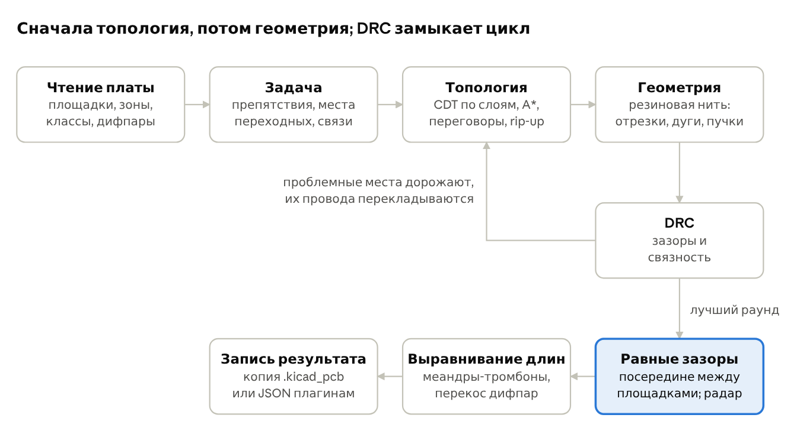
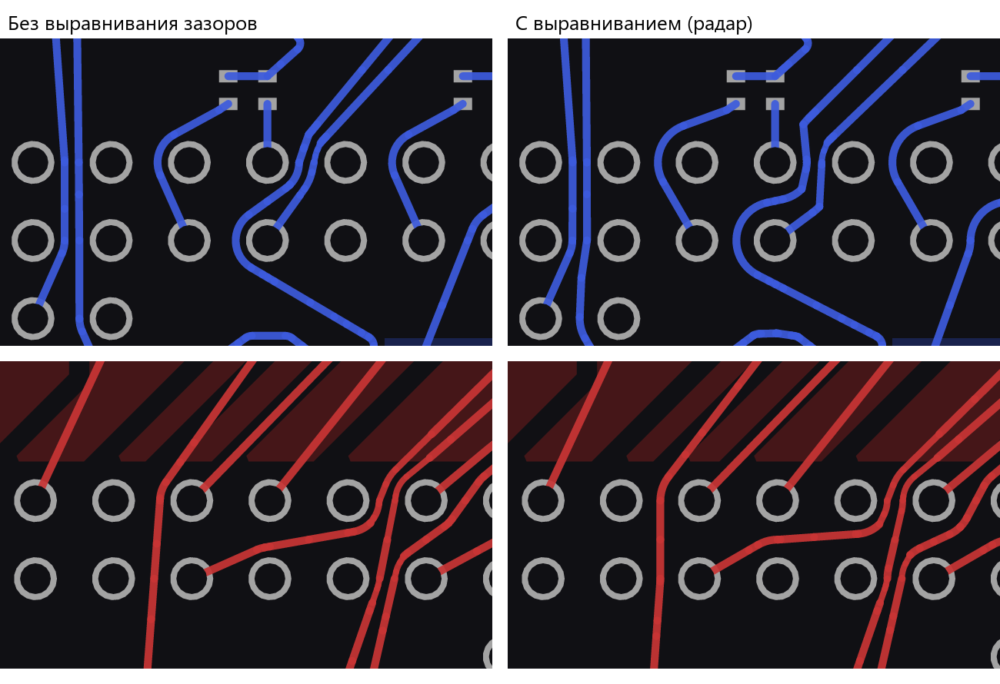

# GridLess: бессеточный топологический автотрассировщик для KiCad 10

*2026-10-20*

*Обновление 2026-11-21: у плагина появились окно прогресса с кнопкой Cancel,
пакет для менеджера плагинов KiCad и перевод интерфейса на все 44 языка KiCad 10.
Более быстрый решатель геометрии также сократил время трассировки; тайминги ниже
относятся к первой версии. Ограничения трассировки по-прежнему актуальны.*

GridLess — бессеточный топологический автотрассировщик для KiCad 10 на Rust, написанный за один день совместной работы инженера и Claude. На эталонной плате, которую инженер развёл вручную, он теперь разводит без ошибок DRC, с меньшим числом переходных, чем ручная разводка, и ведёт дорожки посередине зазоров между выводами.

## Зачем

В KiCad нет своего автотрассировщика; обычный путь — экспорт в Specctra и Freerouting, который ведёт дорожки отрезками под 45°. Цель была другой — трассировщик в духе TopoR: сначала решить топологию (с какой стороны какого препятствия проходит каждый проводник), затем нарисовать дорожки под любыми углами с дугами, чтобы плата выглядела разведённой руками, а не по сетке.

Требования инженер задал в первый же день (2026-10-20):

- **Форма**: ядро на Rust, консольная утилита для `.kicad_pcb` и плагин KiCad 10, который берёт правила прямо из проекта KiCad.
- **Геометрия**: дорожки под любыми углами, дуги вокруг площадок, как в TopoR.
- **Масштаб**: 2–4 слоя, до ~300 цепей.
- **Быстрые цепи**: дифференциальные пары и выравнивание длин.
- **Слои**: предпочтительное направление на каждом слое (один в основном горизонтальный, другой — вертикальный).
- **Переходные**: можно, но как можно меньше; тестовое переходное 0,5 мм / сверло 0,3 мм.
- **Железо**: ускорение на GPU обсудили и отвергли — на таких размерах это ветвистый поиск по графу, для него подходят потоки CPU.

Планка качества — ручная разводка инженера на реальной плате *Carrier*: 4 слоя (внутренний слой 1 — земля), 43 компонента, 281 площадка, 75 цепей, 30 переходных и 1330 мм дорожек.

## Архитектура: сначала топология, потом геометрия

GridLess, как и TopoR, делит трассировку на две задачи: сначала решить, *с какой стороны какого препятствия* идёт каждый проводник, затем вычислить точную форму. Топологию дёшево менять, и она всегда планарна; геометрия считается, когда топология уже хороша.

Перед написанием кода мы изучили аналоги: TopoR, Altium Situs, SPECCTRA, Freerouting, Topola, toporouter из gEDA и статьи о SURF, трассировщик push-and-shove самого KiCad, OrthoRoute. У каждого взяли по идее: у TopoR — разделение топологии и геометрии и концентрические пучки дуг; у Situs и PathFinder — переговорную схему (конфликты разрешены, но всё дорожают); у Freerouting — стоимость направлений слоёв и «лучшая плата сохраняется»; у Topola — crate spade для триангуляции и стопки изгибов; у KiCad — меандры-«тромбоны» и компенсацию перекоса на коротком проводнике.

Этапы:

1. **Чтение платы.** Площадки любой формы, контур, зоны и запреты, медные полигоны, классы цепей из `.kicad_pro`, дифпары по правилам суффиксов KiCad (`_P/_N`, `+/-`, `P/N`) и плоскости — внутренний слой, почти целиком залитый зонами, в том числе разделённый.
2. **Постановка задачи.** Препятствия — скруглённые выпуклые многоугольники; соединения — из остовного дерева каждой цепи, плюс соединения дифпар и переходы к плоскостям; места под переходные расставляются по свободному полю. Площадки с мелким шагом получают короткий прямой отвод.
3. **Топология.** На каждый слой — ограниченная триангуляция Делоне по углам препятствий. Проводник — последовательность пересекаемых рёбер со строгим порядком на каждом ребре, поэтому эскиз планарен по построению. A* ищет по состояниям «ребро + промежуток между уже лежащими проводами»; пересечь чужой провод можно только ценой его перекладки. Перегрузка рёбер допустима со штрафом, растущим от итерации к итерации, и историей конфликтов, как в PathFinder. Отдельный проход пробует каждое соединение с переходными развести без них.
4. **Геометрия.** Новая триангуляция только по реальным препятствиям, провода переносятся в неё. Переменные — точки, где провода пересекают рёбра. Внутри треугольника провод — прямая хорда или дуга вокруг общего угла, и радиус дуги учитывает вложенные провода — концентрические пучки TopoR. Длина минимизируется покоординатным спуском с ограничениями зазоров, начиная с решения алгоритма «воронки» (string pulling). Где места не хватает, дорожки сужаются автоматически.
5. **DRC и обратная связь.** Встроенная проверка зазоров и связности идёт после каждого расчёта геометрии. Проблемные места дорожают в сетке, затронутые провода перекладываются, лучший раунд сохраняется.
6. **Доводка.** Выравнивание зазоров (см. ниже), затем выравнивание длин скруглёнными меандрами-«тромбонами» и компенсация перекоса дифпар.
7. **Вывод.** Отрезки, дуги и переходные в копию `.kicad_pcb` или JSON для плагинов.

Цикл обратной связи делает до восьми раундов и сохраняет лучший; выравнивание зазоров (выделено) и выравнивание длин работают только с этим лучшим раундом.

## Разводить как человек, а не просто проходить DRC

Чистый DRC никогда не считался финишем. Инженер открывал каждый результат в KiCad, сравнивал с ручной разводкой и отвергал платы, формально верные, но некрасивые. Каждое замечание превращалось в правило, стоимость или проход доводки:

| Замечание | Что изменили |
| --- | --- |
| Дифпара USB расслоилась: P на одном слое, N на другом | Пары идут связанно (ведущий и ведомый, держащий зазор пары), остаются на одном слое и могут выбирать эквивалентные выводы |
| Лишние переходы слоёв на выводах разъёмов | Смена слоя на выводе, уже занятом цепью, стоит дороже, и цепочки выводов разъёмов остаются на одном слое |
| Зигзаги и острые изломы на свободном месте | Геометрия резиновой нити вытягивает каждый провод; цепь питания вдоль ряда выводов стала одной прямой |
| Петли и длинные обходы (одна шина данных обходила питание «длинной дорогой») | Два прохода доводки в духе TopoR: каждое соединение перекладывается в одиночку на устоявшейся плате, затем группы «кто кого обходит» перекладываются вместе и остаются, только если итог стал лучше |
| Выравнивание длин везде и на обоих проводниках | Перекос пары считается сквозно через промежуточные компоненты (разъём → защита от статики → микроконтроллер) и компенсируется только на коротком проводнике и только сверх допуска |
| Переходных — как можно меньше (из требований) | Проход минимизации: каждое соединение с переходными перекладывается при запретительно дорогом переходном и остаётся, если не сильно длиннее |

Чтобы не спорить по скриншотам, небольшой скрипт (`tools/analyze_board.py`) измеряет то, что видит глаз: переходные, цепи сразу на нескольких слоях, смену слоя на выводах, острые углы (меньше 120°) и коэффициент обхода каждой цепи. Каждое изменение проверяется им, собственным DRC трассировщика, DRC самого KiCad после перезаливки зон и `cargo test`.

## Интеграция с KiCad: один трассировщик, три входа

Трассировщик — один исполняемый файл; всё остальное — тонкая оболочка вокруг него.

- **Командная строка.** `gridless route board.kicad_pcb -o routed.kicad_pcb` пишет разведённую копию и не трогает исходник. Настройки необязательны: классы цепей и правила берутся из проекта KiCad, а файл `<board>.gridless.toml` рядом с платой добавляет направления слоёв, ширины цепей, дифпары, группы длин и «радар» выравнивания зазоров.
- **Плагин IPC API** (KiCad 10, `kicad-python`). Берёт открытую плату *вместе с несохранёнными правками*, разводит её снимок и вставляет результат одним шагом отмены. Требует *Настройки → Плагины → Включить KiCad API*.
- **Плагин SWIG** (классический ActionPlugin). Работает сразу, но разводит *сохранённый* `.kicad_pcb`, поэтому плату нужно сначала сохранить.

Оба плагина задают три вопроса (сохранить ли существующие дорожки, сколько раундов обратной связи DRC, проверять ли заливки средствами KiCad) и в конце показывают отчёт: переходные, длина, DRC, выравнивание длин. Установщик кладёт оба плагина и исполняемый файл в пользовательские папки KiCad 10.

Одна проблема интеграции получила свой ключ. Цепи плоскостей (здесь GND) соединяются заливками, но доходит ли заливка до площадки, известно только после того, как KiCad зальёт зоны. С `--kicad-check` трассировщик заливает зоны через `kicad-cli`, находит площадки, до которых заливка не достала, ставит к каждой переходное на плоскость и разводит заново.

## Результаты на эталонной плате

На Carrier GridLess не уступает ручной разводке в корректности и выигрывает по переходным: 28 вместо 30 с файлом настроек платы и 21 без настроек вообще, при длине дорожек на 3–4 % меньше. Оценка инженера перед последним раундом доводки — «почти идеально».

| Carrier, 4 слоя, 75 цепей | Ручная разводка | GridLess с настройками | GridLess без настроек |
| --- | --- | --- | --- |
| Ошибки зазоров, замыкания, пересечения (DRC KiCad) | 0 | 0 | 0 |
| Переходные | 30 | 28 | 21 |
| Длина дорожек, мм | 1330 | 1289 (с меандрами) | 1278 |
| Острые углы меньше 120° | — | 2 | 3 |
| Перекос дифпары USB, мм (допуск 0,1) | — | 0,023 | — |
| Время с `--kicad-check`, с | — | ≈ 35 | ≈ 32 |

Файл настроек добавляет дорожки питания 0,8 мм (+5, 3V3, 3V7), группу длин для цепей данных A/B/C (выровнены до 14,44 мм) и дифпару USB; без него трассировщик берёт только классы цепей KiCad. Неподключённые элементы, которые KiCad ещё показывает, — островки заливки GND (один есть и на ручной плате), а не ошибки трассировки.

Вторая плата, *Beacon* (модуль BLE с QFN с шагом 0,4 мм, RF-узлом и разделённой плоскостью питания), пока остаётся открытой задачей: около 20 нарушений DRC и три неподключённые цепи вокруг RF-узла.

## Выравнивание зазоров: посередине, с «радаром»

Резиновая нить прижимает каждую дорожку к площадкам, мимо которых она идёт. Это кратчайший путь, но не то, что рисует конструктор: между двумя близкими выводами дорожка идёт посередине, а пучок дорожек — с равными зазорами. Новый завершающий шаг делает именно это, а «радар» отключает его для далеко стоящих площадок.

**Как это устроено.**

- На каждом ребре сетки между медью двух разных препятствий (площадки любой формы, переходные, неподвижная медь) пересекающие его дорожки получают места с равными зазорами: площадка – дорожка – … – дорожка – площадка.
- Правила главнее. Каждый зазор не меньше своего правила (большее из двух классов цепей). Места раскладываются «заполнением водой»: зазор, чьё правило выше общего уровня, остаётся по правилу, а остальные делят остаток поровну. В тесте три дорожки идут через зазор 1,70 мм, средней нужно 0,25 мм: получается 0,221 / 0,253 / 0,253 / 0,221 мм (лишние 0,003 мм — технологический запас трассировщика сверх каждого правила).
- Радар взвешивает каждый зазор по расстоянию медь–медь между его площадками. До `full` дорожки стоят строго на своих местах, дальше влияние плавно слабеет и исчезает на `range`. По умолчанию это 2 и 5 «каналов» класса Default (ширина дорожки + 2 зазора), 1,3 и 3,25 мм при правилах 0,25 / 0,2 мм. Дорожка может отойти от своего места лишь на (1 − вес) своего запаса.
- Шаг идёт один раз, на геометрии лучшего раунда, когда топология уже зафиксирована: переходные и топология не меняются. Потом снова идёт DRC, и на слое, где выравнивание добавило бы нарушений, остаётся прежняя геометрия.

Одна и та же топология Carrier без выравнивания (слева) и с ним (справа): дорожки между выводами модуля уходят в середины зазоров, а огибание выводов становится одной дугой через их середины.

**Что ломалось по дороге и как чинили.** Первая рабочая версия дорожки центрировала, но плату ухудшала: скрипт анализа насчитал 11 острых углов вместо 2.

| Симптом | Причина | Исправление |
| --- | --- | --- |
| Острые изломы в серединах зазоров | Точка, закреплённая в середине зазора, — это препятствие нулевого радиуса | Огибать площадку большим радиусом, достающим до середины зазора; дуги вокруг двух площадок зазора касаются именно там |
| Пучки «расплываются» волнами по свободному месту | Радар мерил зазор на одну дорожку — даже на 6 мм он мал, если дорожек пять | Радар по расстоянию между площадками, как его и определил инженер |
| Центровка между площадками в 6 мм друг от друга | Расстояние умножалось на синус угла пересечения, а у скользящих дорожек он мал | Просто расстояние между площадками |
| Изломы в центрах ячеек сетки выводов | Середина диагонали ячейки дальше от огибаемого вывода, чем середины зазоров строки и столбца | При огибании вывода держать расстояние самого узкого зазора «веера»: одна дуга |
| Свободные точки пересечения «прячутся» внутрь большого радиуса | Внутри него дуга отключалась, и прямая хорда была короче | Мягкий штраф выталкивает концы хорд из центровочных кругов |
| Крайние зазоры 0,2075 и 0,221 мм в симметричной задаче | Расчёт вдоль ребра занижает зазор у круглых выводов при наклонных дорожках; а сосед сдвинул точку на 5 мкм внутрь радиуса дуги, и она скачком вернулась к радиусу правил | «Заполнение водой» поперёк дорожек, выводы — как круги; радиус непрерывно уменьшается до конца хорды, но не ниже правила |
| KiCad счёл дорожку висящей | Дуга 0,067 мм со стрелкой прогиба 0,5 мкм внутри площадки | Дуги площе 1 мкм пишутся отрезками |

На Carrier итоговая версия сохраняет переходные и топологию, добавляет 0,8 % длины и около секунды, а число острых углов вернулось к тем же 2, что и у обычной резиновой нити. На плотной плате Beacon она не добавляет нарушений: на F.Cu они бы появились, поэтому этот слой автоматически остаётся с прежней геометрией.

## Детерминированность трассировки

Одна и та же сборка на одной и той же плате должна давать одинаковый результат; теперь даёт — побайтно. При проверке выравнивания зазоров на Beacon одна и та же сборка выдала в одном прогоне 20 переходных, а в другом 46.

Очевидные подозреваемые — `HashMap` в топологическом трассировщике — оказались ни при чём: там они только для поиска по ключу. Виновата была проверка DRC. Она собирала нарушения обходом пространственного хеша через `HashMap::values()`, а Rust в каждом процессе случайно меняет порядок хеша. Дальше нарушения сортировались только по зазору, при равных зазорах оставался случайный порядок, а удаление дубликатов оставляло «первое» из почти одинаковых. В итоге в каждом прогоне выживало своё «представительное» нарушение — в другой точке и с другой дорожкой. Обратная связь DRC штрафует именно эти точки и перекладывает именно эти провода, поэтому прогоны совпадали в раундах 0 и 1 (*число* нарушений от порядка не зависит) и расходились со 2-го.

Исправление небольшое. Ячейки сетки обходятся в отсортированном порядке, нарушения сортируются полностью (зазор, затем координаты, затем имена объектов), а подпись цепочки дифпары начинается с конца с меньшим номером. Новый тест шесть раз запускает DRC на сетке из 64 одинаковых пересечений и требует одинаковых отчётов; на старом коде он падает, на новом проходит. Beacon теперь разводится одинаково пять раз из пяти, Carrier — тоже, с настройками и без. Правило на будущее: хеш-таблицу можно использовать для поиска, но нельзя обходить там, где порядок что-то решает.

Лучше Beacon от этого не стал — он стал измеримым. Без детерминированности половина любого сравнения «до/после» на плотной плате — шум.

## Что ещё можно улучшить

Ядро трассировщика обогнало его интерфейс: в KiCad плагин пока — это диалог из трёх вопросов и текстовый отчёт, а главный пробел в самой трассировке — плотные платы. Примерно в порядке ценности:

| Область | Улучшение | Зачем |
| --- | --- | --- |
| Плагин | Окно хода работы с живым логом и кнопкой «Отмена» | Трассировка с проверкой заливок идёт 30–40 с, и всё это время KiCad ничего не показывает; лог плагина IPC уходит в невидимую консоль |
| Плагин | Диалог настроек, записывающий `<board>.gridless.toml` | Направления слоёв, ширины цепей, дифпары, группы длин и радар сейчас задаются ручной правкой TOML |
| Плагин | Разводка выделенного: выбранных цепей или области | Сейчас — вся плата или всё недостающее с «сохранить существующие» |
| Плагин | Показывать находки DRC трассировщика маркерами KiCad и самому перезаливать зоны, где это позволяет API | Отчёт — простой текст, а заливки надо перезаливать вручную (B) |
| Плагин | Пакет для менеджера плагинов и контента KiCad с готовыми сборками под Windows, Linux и macOS | Сейчас установка — это `cargo build` и установщик на Python; к тому же плагин SWIG разводит только сохранённый файл |
| Трассировка | Плотные корпуса: шаблоны выхода из QFN 0,4 мм, исключения для запретных зон RF-узлов | На Beacon остаются около 20 нарушений и 3 неподключённые цепи |
| Трассировка | Сшивающие переходные для островков заливки | На Carrier островки заливки GND по-прежнему видны как неподключённые |
| Трассировка | Предпочтительные направления слоёв и в финальной геометрии, а не только в топологии | Резиновая нить изотропна, поэтому на «горизонтальных» слоях остаются диагонали |
| Трассировка | Резерв длины под выравнивание уже на этапе топологии, как в TopoR; переходные «парой» для дифпар | Меандры помещаются только на прямых участках, иначе цель помечается как недостигнутая |
| Трассировка | Более гладкий вход в площадки и заход пучков в зазоры | Осталось несколько мелких изломов там, где провод входит в свою площадку через её угол |
| Ядро | Параллельные варианты на потоках CPU с разными порядками и весами и выбор лучшего | Архив вариантов TopoR; теперь возможно, потому что прогон воспроизводим |
| Ядро | Более быстрый решатель геометрии, чем покоординатный спуск | На некоторых слоях релаксация упирается в предел 200 проходов — это время и лёгкая «дрожь» дорожек |
